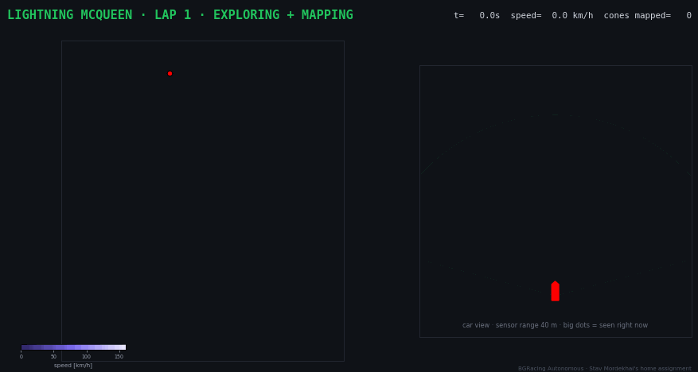
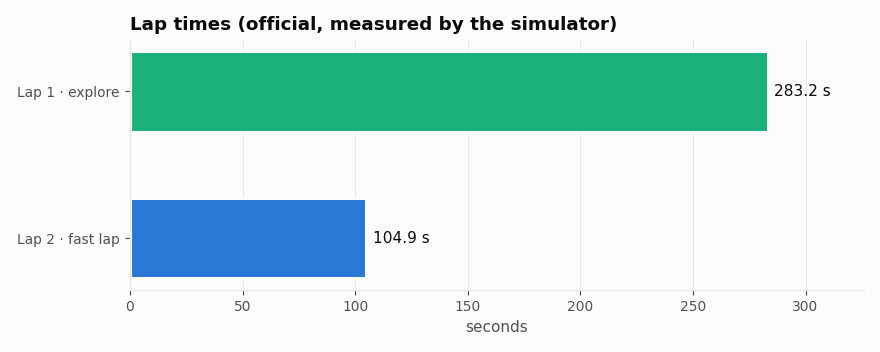
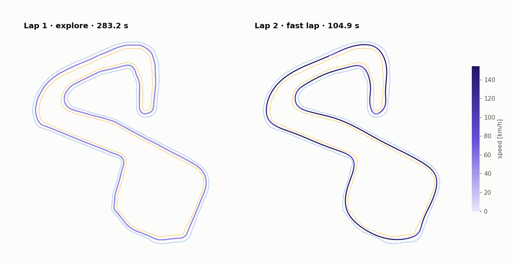
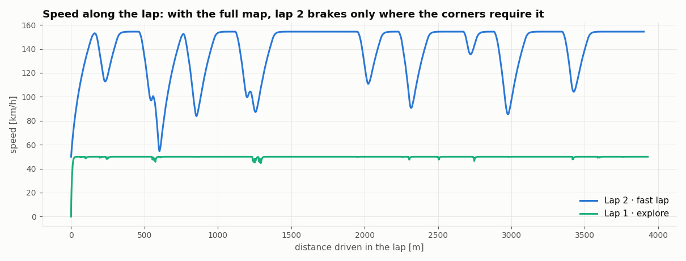
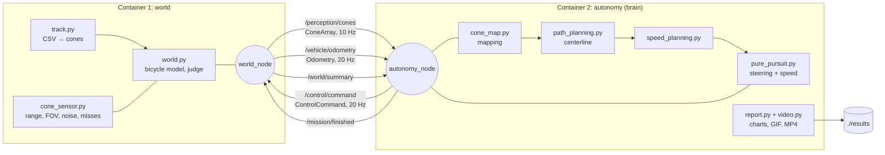
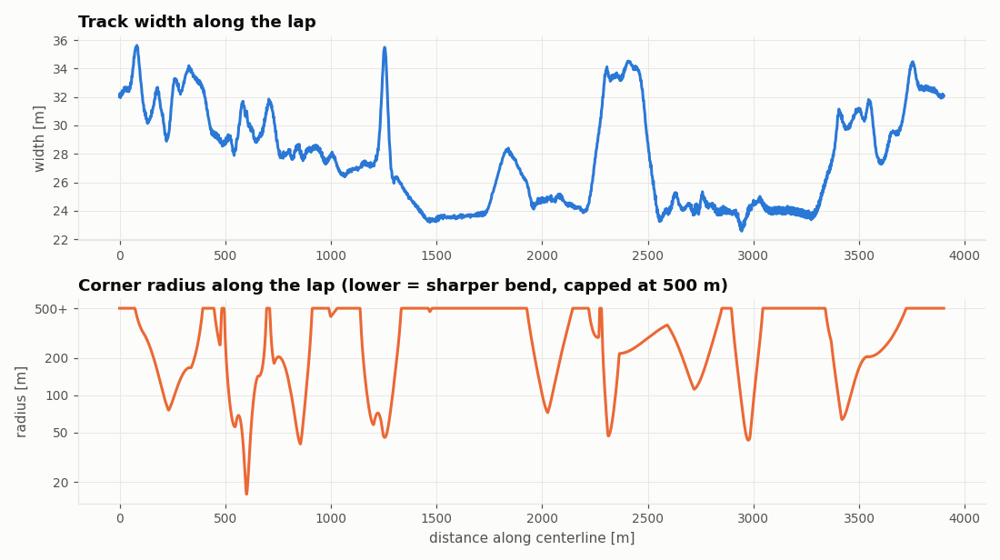
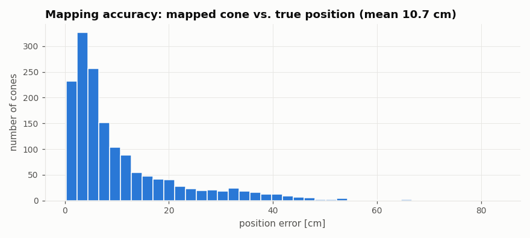

# Mini Driverless Car: EXPLORE+MAP lap then FAST lap

A two-container **ROS 2 Jazzy** pipeline in which a simulated car drives the
**Brands Hatch** circuit by itself. It first

1. **explores** the unknown track slowly, seeing only nearby cones, and **builds a map**,
2. uses the finished map to plan the whole track before driving a **fast lap**.



*Left: the map being built (the cones appear only when the car sees them), with the car's each trail colored by its speed.
Right: the car's own view: what the sensor sees right now and the path it planned.*

---

## Results

| Lap | Strategy | Lap time | Cones hit |
|---|---|---|---|
| 1 | Explore track and map (plans only from the cones seen so far) | **283.2 s** | 0 |
| 2 | Fast lap on the centerline of the built map, with a planned speed for every point | **104.9 s** | 0 |

| Metric | Value |
|---|---|
| Cones mapped / true cones | 1572 / 1572 (0 duplicates, 0 missed) |
| Mean map error | ≈ 11 cm (95 % of cones within ≈ 35 cm) |
| Max distance from planned path on lap 2 | 1.71 m |
| Top speed | 154 km/h |

Results are **reproducible** as required: running `docker compose up` again gives the same lap times (*Lockstep simulation* below).
(*Only the mapping statistics can differ by a few millimeters between runs, because ROS may deliver a cone message and an odometry message
with the same timestamp in either order. All numbers come from [`results/summary.json`](results/summary.json)).

<p align="center"></p>





---

## Architecture



This is not a one-way pipeline- this is a **closed feedback loop**: the brain's commands change what the sensor sees next.

| Topic | Type | From → To | Content |
|---|---|---|---|
| `/perception/cones` | `msgs/ConeArray` | world → autonomy | Cones the sensor sees, in the car frame (x forward, y left) |
| `/vehicle/odometry` | `nav_msgs/Odometry` | world → autonomy | Car position, heading (quaternion), speed |
| `/control/command` | `msgs/ControlCommand` | autonomy → world | Steering angle [rad], acceleration [m/s²] |
| `/mission/finished` | `std_msgs/Bool` | autonomy → world | Car has stopped after the last lap |
| `/world/summary` | `std_msgs/String` (JSON) | world → autonomy | Official lap times, cones hit |
| `/world/ground_truth_cones` | `msgs/ConeArray` | world → autonomy | True cones, used **only to score the map** in the report, never for driving |
| `/autonomy/map` | `msgs/ConeArray` | autonomy → (debug) | Map built so far, 1 Hz |
| `/autonomy/mode` | `std_msgs/String` | autonomy → (debug) | The car's current mode, sent each time it changes |

Custom messages live in [`ros2_ws/src/msgs/msg`](ros2_ws/src/msgs/msg).

**Design choice: logic without ROS.** `world.py` and `brain.py` have no ROS code in them. The nodes are thin wrappers that convert messages.
This makes the algorithms testable on their own ([`tools/offline_run.py`](tools/offline_run.py) runs the identical pipeline in Python in about 15 s).

**Lockstep simulation.** Every 50 ms of simulated time the world publishes odometry and **waits** for the command answering that
exact timestamp before continuing, in turns. Together with a fixed random seed for the sensor noise, the result is the
same on any computer. A `real_time_factor` parameter can also slow it down to real time.

---

## Dataset: `BrandsHatchLayout.csv`

The CSV holds `x, y, side` points along the left and right edges of the Brands Hatch Grand Prix circuit, in meters.

| Property | Value |
|---|---|
| Points | 156 left + 156 right (spaced ~16–37 m apart, mean 25.7 m) |
| Left / right edge length | 4019 m / 3826 m |
| Centerline length | ≈ 3.9 km |
| Track width | min 22.6 m, mean 27.6 m, max 35.5 m |
| Generated cones (every 5 m) | 803 blue (left), 765 yellow (right), 4 orange (start line) |
| Tightest corner (centerline) | radius ≈ 20 m |

Preprocessing ([`track.py`](ros2_ws/src/world/world/track.py)): empty separator rows are skipped. Each edge is fitted with a closed (periodic)
spline and resampled every 5 m to place cones, following the "Formula Student" colors (blue = left, yellow = right, orange = start/finish).



---

## How it works

| Stage | File | The idea |
|---|---|---|
| Car physics | [`vehicle.py`](ros2_ws/src/world/world/vehicle.py) | Bicycle model with steering lag, engine/brake limits, drag, and a **tire grip limit** (v²/R ≤ a_lat,max; too fast means the car runs wide) |
| Perception (simulated) | [`cone_sensor.py`](ros2_ws/src/world/world/cone_sensor.py) | 40 m range, 150° field of view, 5 % missed cones, noise that grows with distance |
| Mapping | [`cone_map.py`](ros2_ws/src/autonomy/autonomy/cone_map.py) | Car frame → world frame, match each detection to the nearest known cone of the same color, weighted averaging |
| Local planning (lap 1) | [`path_planning.py`](ros2_ws/src/autonomy/autonomy/path_planning.py) | Midpoints between blue/yellow cone pairs, chained forward from the car |
| Global centerline | same | All midpoints ordered along the lap-1 path, smoothed with a closed spline |
| Speed plan | [`speed_planning.py`](ros2_ws/src/autonomy/autonomy/speed_planning.py) | Corner limit v = √(a_lat · R), then a forward pass (acceleration limit) and a backward pass (brake in time) |
| Control | [`pure_pursuit.py`](ros2_ws/src/autonomy/autonomy/pure_pursuit.py) | **Pure Pursuit**: steer toward a point a few meters ahead on the path (further ahead at higher speed); Proportional speed control |
| Mission logic | [`brain.py`](ros2_ws/src/autonomy/autonomy/brain.py) | State machine EXPLORE → FAST → FINISH, switching at the start line |

### Problems found and fixed along the way

- **Time synchronization.** At 150 km/h, using a car pose only 0.05 s old placed every detected cone 2 m off, which produced duplicate cones in the map.
  The brain now keeps a short pose history and **looks up where the car was at the sensor's timestamp**.
- **Timestamp rounding bug.** Converting t = 4.9999999 s to ROS `(sec, nanosec)` by splitting first gave `nanosec = 1e9`, so time jumped back 1 s.
  The car drove off the track. The fix: convert to whole nanoseconds first, then split.
- **Noisy far detections.** At 3× sensor noise the map filled with duplicate cones and the car left the track.
  Letting near sightings count more than far ones (weight = 1/σ²) and ignoring detections beyond 32 m fixed it.

### Robustness experiments

Sensor noise multiplier and detection probability were varied (`tools/offline_run.py` with `NOISE` / `DETECT`):

| Noise × | Detection prob. | Lap 1 | Lap 2 | Cones hit |
|---|---|---|---|---|
| 1 | 0.95 (default) | 283.3 | 104.9 | 0 |
| 2 | 0.95 | 283.9 | 104.0 | 0 |
| 3 | 0.95 | 284.4 | 104.0 | 0 |
| 4 | 0.95 | 309.2 | 104.5 | 0 |
| 5 | 0.95 | **fails**: map too noisy, car leaves the track on lap 1 | | |
| 1 | 0.5 | 283.8 | 103.8 | 0 |
| 1 | 0.3 | 283.6 | 103.7 | 0 |
| 3 | 0.7 | 285.5 | 103.7 | 0 |

Missed detections barely matter, because each cone is seen many times. Noise is the real limit: at 5× (σ ≈ 1.1 m at 40 m),
detections can no longer be matched to the right cone.



---

## How to run the project

```bash
git clone <repo>
cd driverless-racecar
docker compose up --build
```

- The first build downloads the ROS 2 image (≈1 GB).
- The run takes a few minutes: the ~390 s mission is simulated faster than real time, then the brain renders the charts and video. Both containers exit on their own, and the race ends with a checkered-flag finish banner in the terminal showing the official results.
- Outputs appear in **`./results`**: `drive.gif`, `drive.mp4`, the charts, `summary.json`, `sim_summary.json`, `run_log.csv`.

### Quick runs without ROS (for experiments)

`tools/offline_run.py` runs the same world and brain code in one Python process,
without ROS or Docker. A full race takes about 15 seconds instead of a few minutes,
which makes it practical to test many settings and easier to debug.

```bash
docker compose build
docker run --rm -v "${PWD}:/app" -w /app driverless-racecar-autonomy python3 tools/offline_run.py
```

**Parameters** (edit `command:` in [`docker-compose.yml`](docker-compose.yml); keep decimals for float values, meaning `2.0`, not `2`):

| Parameter | Node | Default | Effect |
|---|---|---|---|
| `sensor_noise_scale` | world | `1.0` | Multiply the sensor noise |
| `detection_probability` | world | `0.95` | Chance a visible cone is detected |
| `seed` | world | `0` | Random seed |
| `real_time_factor` | world | `0.0` | `0` = as fast as possible, `1.0` = real time |
| `make_video` | autonomy | `true` | Render GIF/MP4 at the end |
| `car_name` | world, autonomy | `Lightning McQueen` | The car's name in the logs, the video and the finish banner |

---

## Repo structure

```
├── data/BrandsHatchLayout.csv          track edges (the given dataset)
├── docker/                             Dockerfiles, entrypoint, Fast DDS network profile
├── docker-compose.yml                  runs both containers
├── ros2_ws/src/
│   ├── msgs/                       custom messages: Cone, ConeArray, ControlCommand
│   ├── world/                        CONTAINER 1: track, vehicle, sensor, world, world_node
│   └── autonomy/                   CONTAINER 2: map, planning, speed, control, brain,
│                                       report, video, autonomy_node
├── tools/offline_run.py                same pipeline without ROS, for fast testing
└── results/                            outputs of the last run
```

## Limitations and future work (how I would improve)

- **Racing line.** The fast lap follows the middle of the road. Using the full track width (outside, apex, outside) would allow
  gentler curves and higher corner speeds. This is the next step.
- Perception is simulated. A real system would produce the same cone list from a camera detector trained on **FSOCO** or from LiDAR clustering.
- Localization is assumed (noisy odometry is given). Full **SLAM** would estimate the car's position and the map together.
- The car model is kinematic. A dynamic model with tire slip would be more realistic at high speed.


## Some sources

- [PythonRobotics](https://github.com/AtsushiSakai/PythonRobotics): Python examples of the bicycle model and pure pursuit
- [ROS 2 Jazzy tutorials](https://docs.ros.org/en/jazzy/Tutorials.html): publishers, subscribers, custom messages
- [TUMFTM racetrack database](https://github.com/TUMFTM/racetrack-database): real race track layouts as csv files
- (https://www.youtube.com/watch?v=1YBFcHY_gWE): "Accurate Mapping and Planning for Autonomous Racing"
- (https://www.youtube.com/watch?v=x9s8J4ucgO0): "F1TENTH L10 - Pure Pursuit"
- (https://www.youtube.com/watch?v=FYtxBiH6_Ps): "Ep 3_Coding Vehicle Dynamics: The Bicycle Model Explained | Python Simulation"
- (https://www.youtube.com/watch?v=EU-QaO6xTv4): "F1TENTH T01 - Tutorial on Docker and ROS2"
